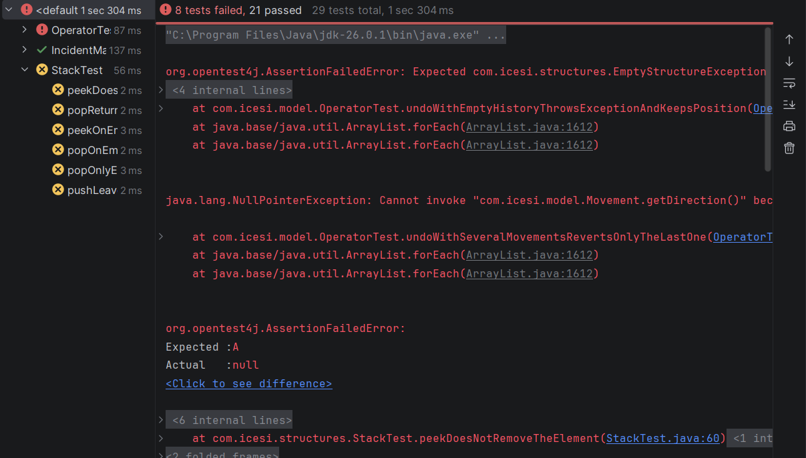
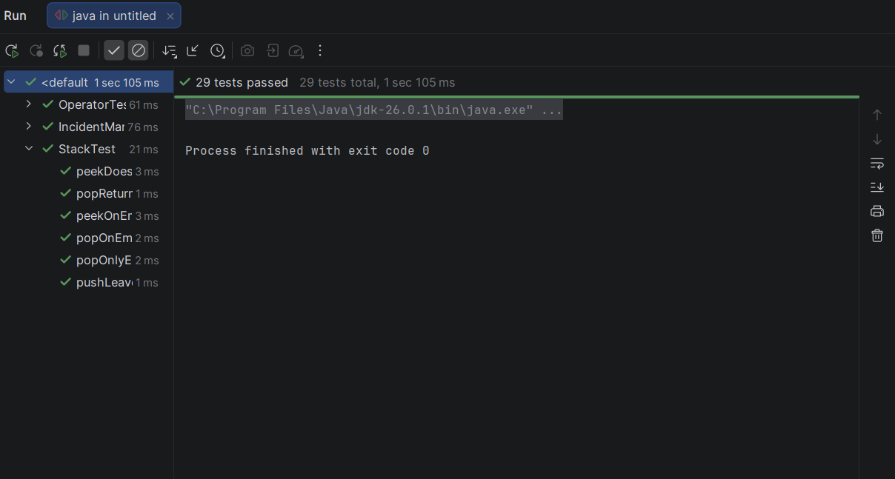
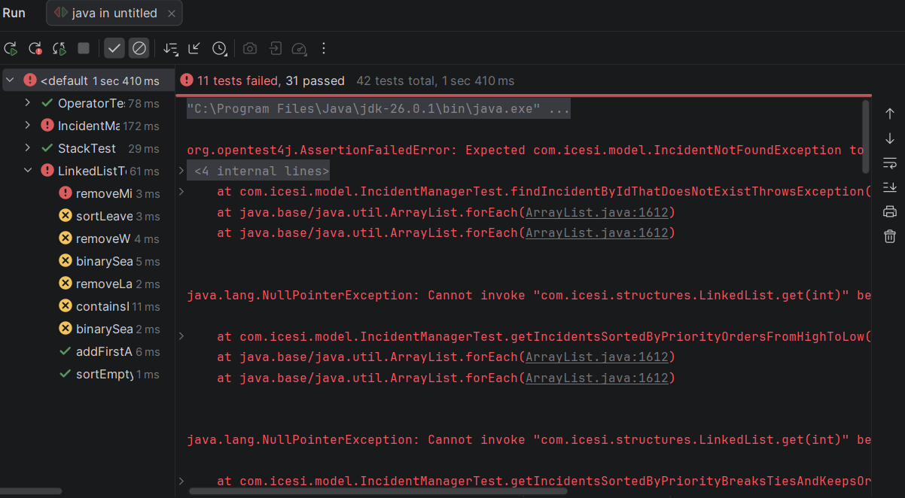
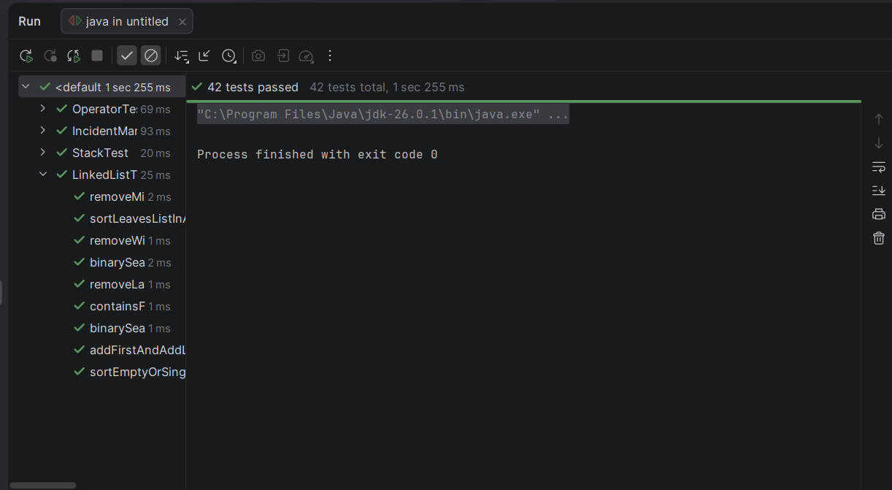
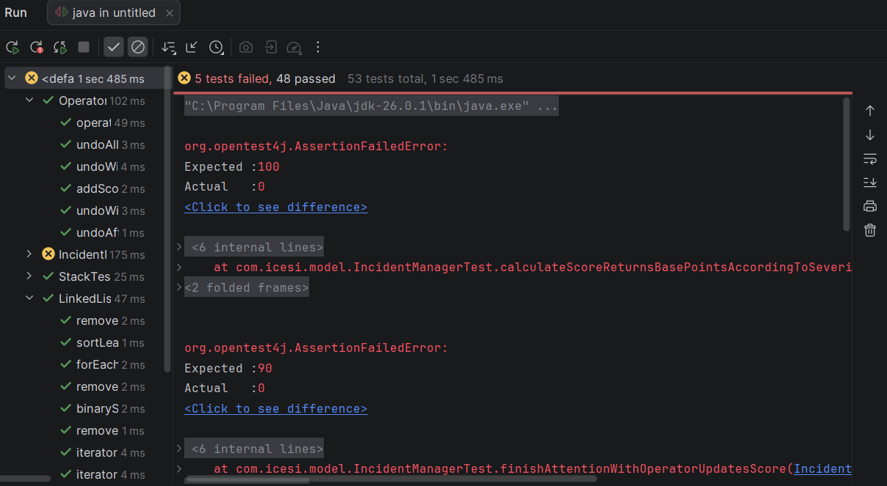
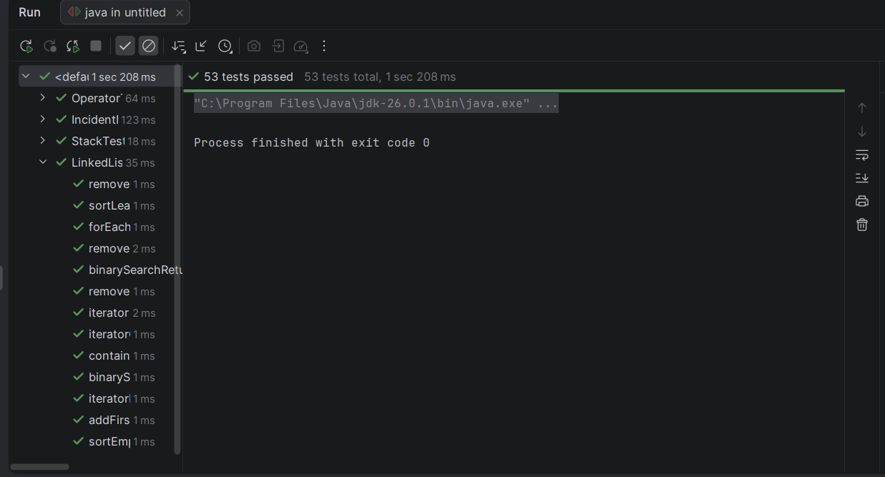
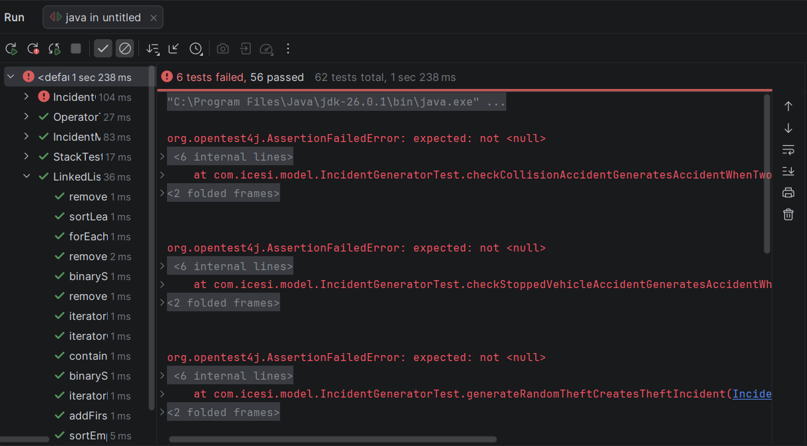
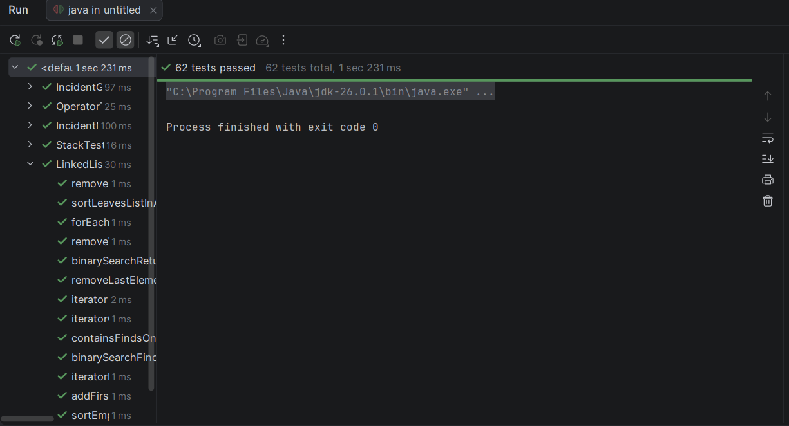
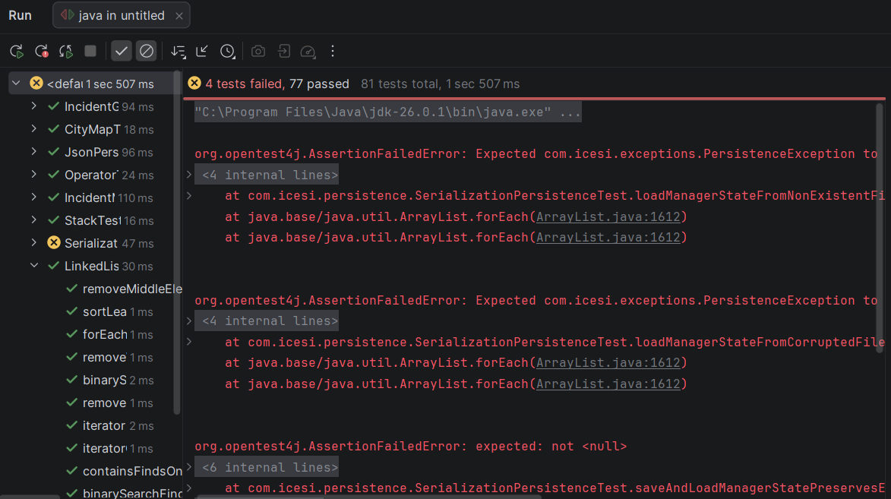
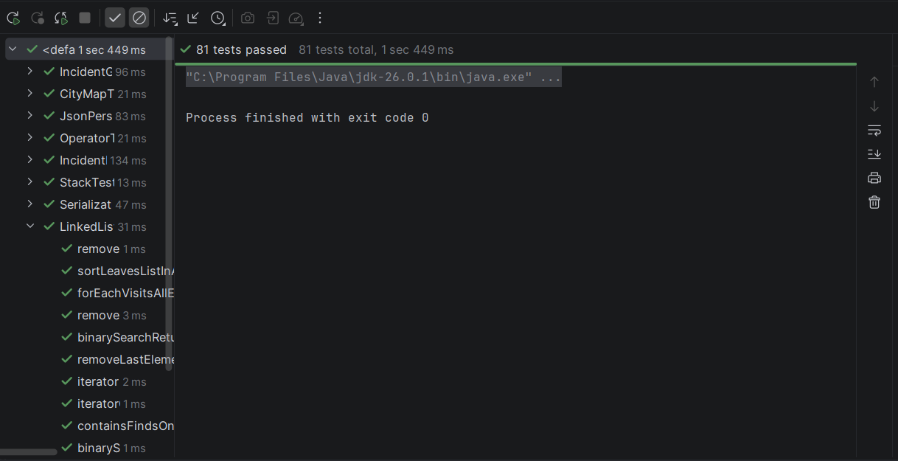

# SGMMS — Sistema de Gestión y Monitoreo de Movilidad y Seguridad (Palmira)

Tarea Integradora — Algoritmos y Programación II (Entrega 2)  
**Equipo:** LaVencida

## Integrantes del Equipo
- **Juan Pablo Ceballos** — Código: `A00410783`
- **Daniel Felipe Herrera Parra** — Código: `A00413908`
- **Dayanna Fernández Núñez** — Código: `A00403756`

## Descripción del Proyecto
El **Sistema de Gestión y Monitoreo de Movilidad y Seguridad (SGMMS)** es una aplicación desarrollada en Java bajo arquitectura MVC que simula un centro de monitoreo urbano para la ciudad de Palmira. Permite representar un mapa urbano de 64×64, registrar y generar incidentes (robos, incendios y accidentes de tránsito bajo criterios operativos), priorizarlos por gravedad y antigüedad, buscarlos mediante búsqueda binaria, sugerir y asignar vehículos compatibles, gestionar el desplazamiento del operador con historial en pila LIFO, calcular el puntaje de desempeño e indicadores en tiempo real, y persistir la información mediante archivos JSON y serialización binaria, empleando exclusivamente estructuras de datos enlazadas genéricas propias (`LinkedList<T>`, `Stack<T>`, `Node<T>`).

---

## Indicadores de calidad

Esta sección reporta el avance del proyecto a través de 15 commits representativos, siguiendo el ciclo TDD (Red → Green). Las métricas se calculan sobre el estado de las pruebas unitarias en el momento de cada commit.

Fórmulas:
- Densidad de errores-fallos = total de fallos / total de pruebas
- Confiabilidad = 1 - densidad de fallos
- Completitud = casos de prueba / total funcionalidades (6 iniciales / 17 totales)

Iteración 1: 4ed0164 (esqueleto de registerIncident — aún sin pruebas)
Densidad de errores-fallos = N/A (0 pruebas aún)
Confiabilidad = N/A
Completitud = 0.0 (0/6)

Iteración 2: 6b4425e (pruebas unitarias de registerIncident en fase Red)
Densidad de errores-fallos = 1.0 (4/4)
Confiabilidad = 0.0
Completitud = 0.67 (4/6)

Iteración 3: 8b7a3ee (registerIncident implementado, pruebas en fase Green)
Densidad de errores-fallos = 0.0 (0/4)
Confiabilidad = 1.0
Completitud = 0.67 (4/6)

Iteración 4: 55f3074 (pruebas de assignVehicle en fase Red)
Densidad de errores-fallos = 0.33 (4/12)
Confiabilidad = 0.67
Completitud = 2.0 (12/6)

Iteración 5: 9ae2a55 (assignVehicle implementado, pruebas en fase Green)
Densidad de errores-fallos = 0.0 (0/12)
Confiabilidad = 1.0
Completitud = 2.0 (12/6)

Iteración 6: c5bc885 (pruebas de Stack y undoLastMovement en fase Red)
Densidad de errores-fallos = 0.34 (10/29)
Confiabilidad = 0.66
Completitud = 1.71 (29/17)

Iteración 7: d105945 (Stack y undoLastMovement implementados, pruebas en fase Green)
Densidad de errores-fallos = 0.0 (0/29)
Confiabilidad = 1.0
Completitud = 1.71 (29/17)

Iteración 8: 8cc1ffa (pruebas de LinkedList, sort y binarySearch en fase Red)
Densidad de errores-fallos = 0.31 (13/42)
Confiabilidad = 0.69
Completitud = 2.47 (42/17)

Iteración 9: 0d95098 (LinkedList, sort y binarySearch implementados, pruebas en fase Green)
Densidad de errores-fallos = 0.0 (0/42)
Confiabilidad = 1.0
Completitud = 2.47 (42/17)

Iteración 10: 411963e (pruebas de puntaje del operador RF-14 en fase Red)
Densidad de errores-fallos = 0.13 (7/53)
Confiabilidad = 0.87
Completitud = 3.12 (53/17)

Iteración 11: a10a9ba (puntaje del operador RF-14 implementado, pruebas en fase Green)
Densidad de errores-fallos = 0.0 (0/53)
Confiabilidad = 1.0
Completitud = 3.12 (53/17)

Iteración 12: 3007318 (pruebas de IncidentGenerator RF-4 en fase Red)
Densidad de errores-fallos = 0.15 (9/62)
Confiabilidad = 0.85
Completitud = 3.65 (62/17)

Iteración 13: c9a7242 (IncidentGenerator RF-4 implementado, pruebas en fase Green)
Densidad de errores-fallos = 0.0 (0/62)
Confiabilidad = 1.0
Completitud = 3.65 (62/17)

Iteración 14: f2bed44 (pruebas de CityMap, JsonPersistence y SerializationPersistence en fase Red)
Densidad de errores-fallos = 0.05 (4/81)
Confiabilidad = 0.95
Completitud = 4.76 (81/17)

Iteración 15: 7510344 (CityMap, JsonPersistence y SerializationPersistence implementados, fase Green final)
Densidad de errores-fallos = 0.0 (0/81)
Confiabilidad = 1.0
Completitud = 4.76 (81/17)
