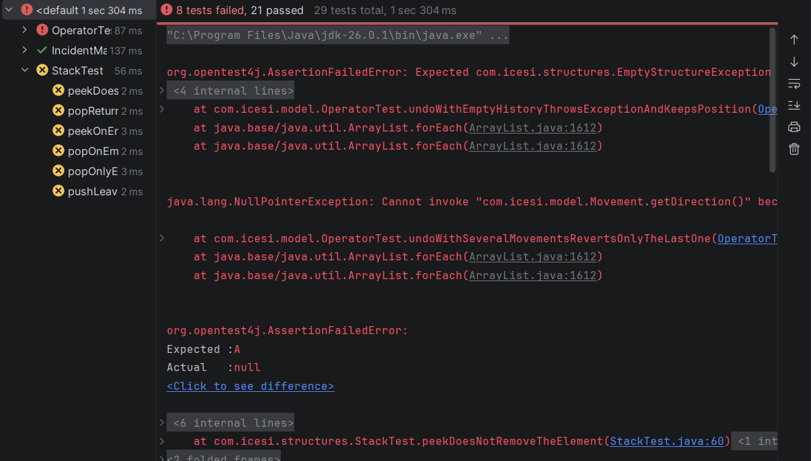
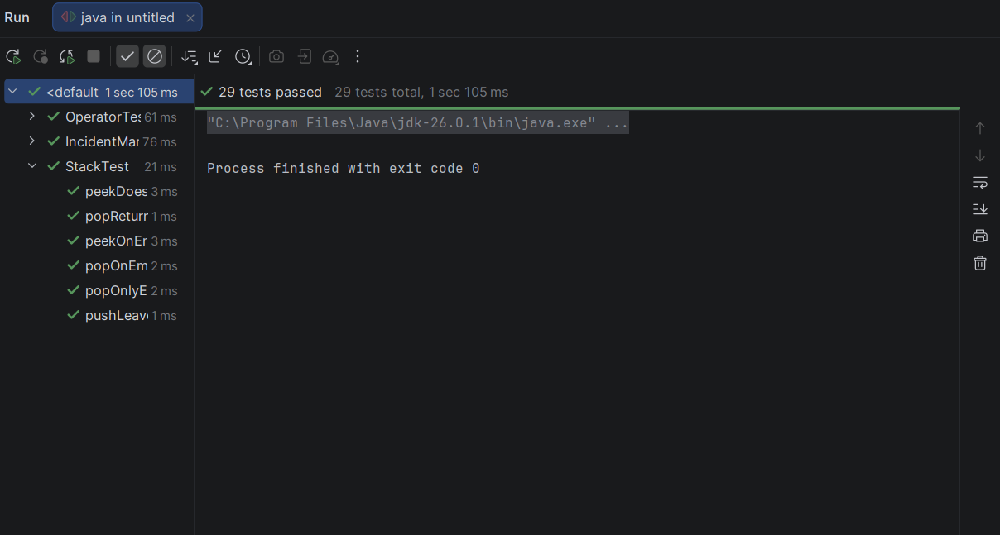
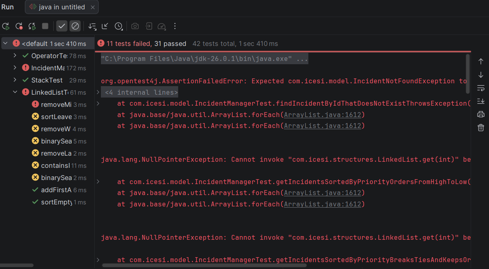
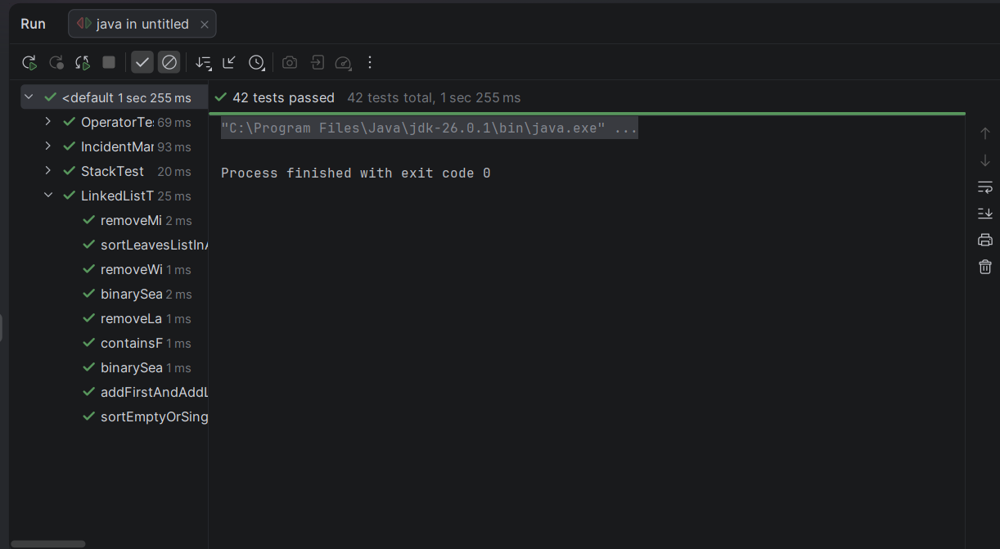
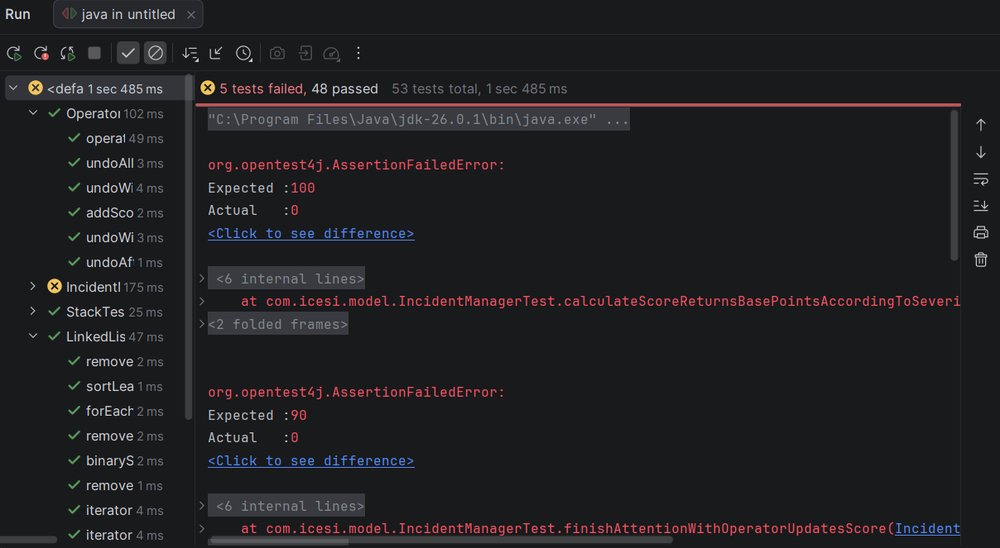
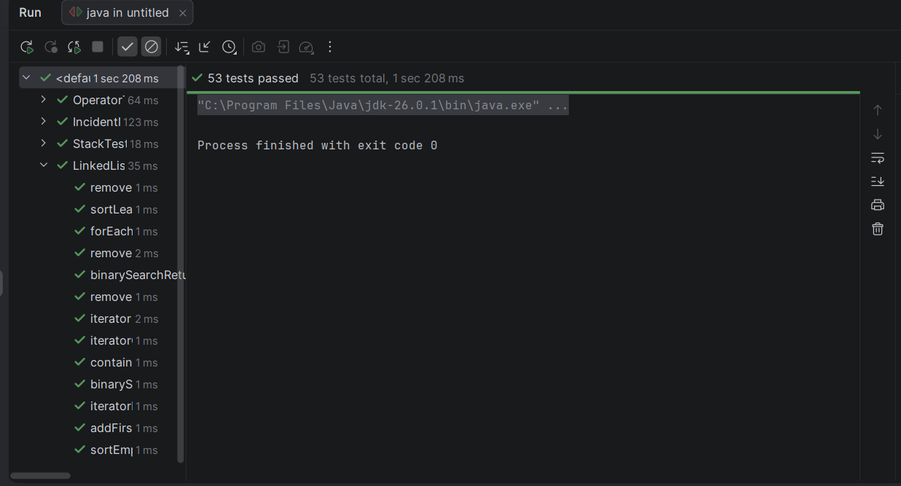
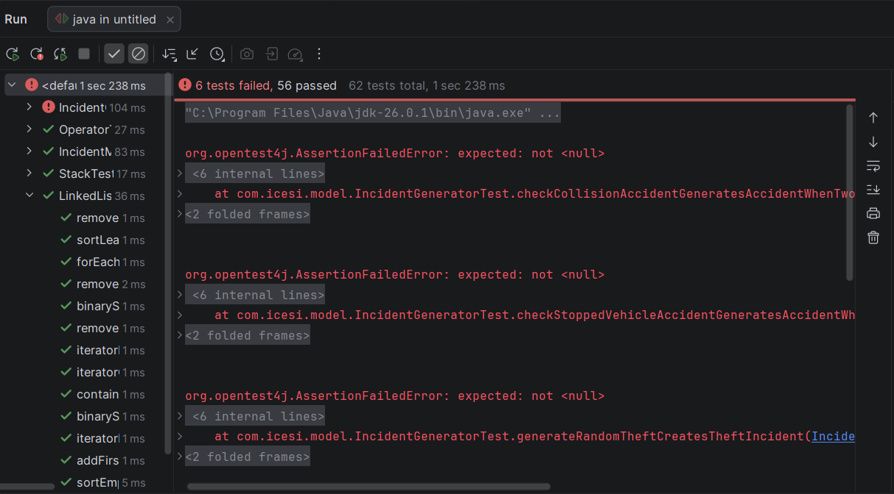
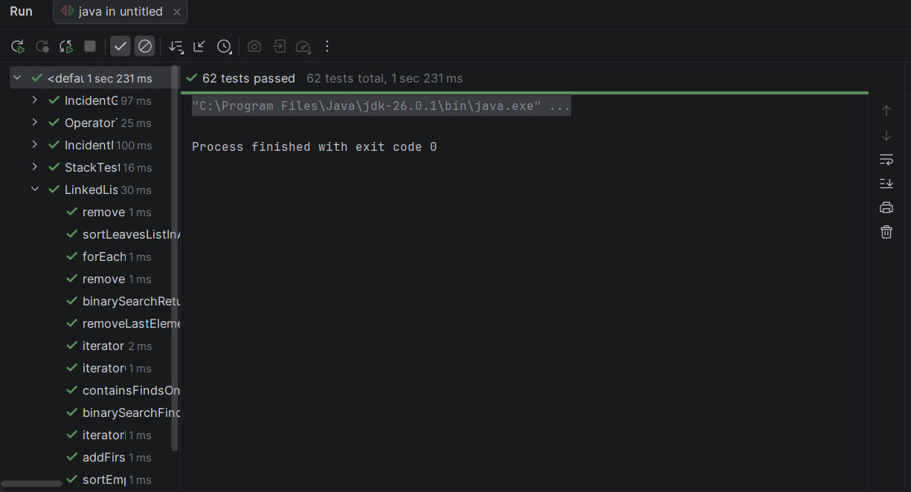
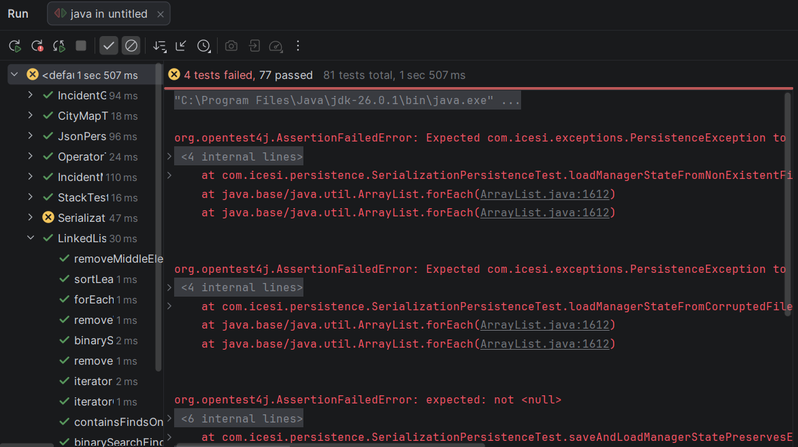
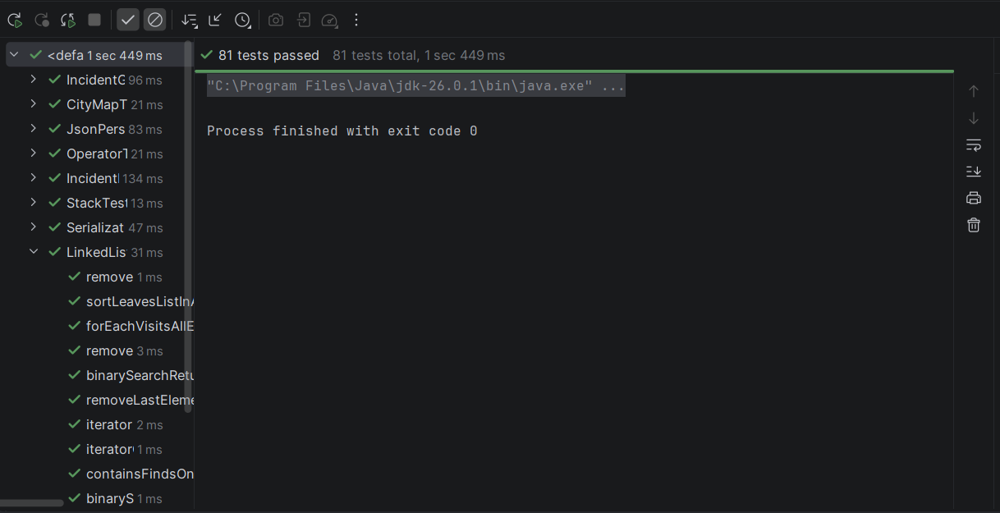

# SGMMS — Sistema de Gestión y Monitoreo de Movilidad y Seguridad (Palmira)

Tarea Integradora — Algoritmos y Programación II (Entrega 3 - Final)  
**Equipo:** LaVencida

## Integrantes del Equipo
- **Juan Pablo Ceballos** — Código: `A00410783`
- **Daniel Felipe Herrera Parra** — Código: `A00413908`
- **Dayanna Fernández Núñez** — Código: `A00403756`

## Descripción del Proyecto
El **Sistema de Gestión y Monitoreo de Movilidad y Seguridad (SGMMS)** es una aplicación desarrollada en Java bajo arquitectura MVC que simula un centro de monitoreo urbano para la ciudad de Palmira. Permite representar un mapa urbano de 64×64, registrar y generar incidentes (robos, incendios y accidentes de tránsito bajo criterios operativos), priorizarlos por gravedad y antigüedad, buscarlos mediante búsqueda binaria, sugerir y asignar vehículos compatibles, gestionar el desplazamiento del operador con historial en pila LIFO, calcular el puntaje de desempeño e indicadores en tiempo real, y persistir la información mediante archivos JSON y serialización binaria, empleando exclusivamente estructuras de datos enlazadas genéricas propias (`LinkedList<T>`, `Stack<T>`, `Node<T>`).

---

## Indicadores de calidad

Esta sección reporta el avance del proyecto a través de 15 commits representativos, siguiendo el ciclo TDD (Red → Green). Las métricas se calculan sobre el estado de las pruebas unitarias en el momento de cada commit.

Fórmulas:
- Densidad de errores-fallos = total de fallos / total de pruebas
- Confiabilidad = 1 - densidad de fallos
- Completitud = casos de prueba / total funcionalidades (6 iniciales / 17 totales)

Iteración 1: 4ed0164 (esqueleto de registerIncident — aún sin pruebas)
Densidad de errores-fallos = N/A (0 pruebas aún)
Confiabilidad = N/A
Completitud = 0.0 (0/6)

Iteración 2: 6b4425e (pruebas unitarias de registerIncident en fase Red)
Densidad de errores-fallos = 1.0 (4/4)
Confiabilidad = 0.0
Completitud = 0.67 (4/6)


Iteración 3: 8b7a3ee (registerIncident implementado, pruebas en fase Green)
Densidad de errores-fallos = 0.0 (0/4)
Confiabilidad = 1.0
Completitud = 0.67 (4/6)


Iteración 4: 55f3074 (pruebas de assignVehicle en fase Red)
Densidad de errores-fallos = 0.33 (4/12)
Confiabilidad = 0.67
Completitud = 2.0 (12/6)


Iteración 5: 9ae2a55 (assignVehicle implementado, pruebas en fase Green)
Densidad de errores-fallos = 0.0 (0/12)
Confiabilidad = 1.0
Completitud = 2.0 (12/6)


Iteración 6: c5bc885 (pruebas de Stack y undoLastMovement en fase Red)
Densidad de errores-fallos = 0.34 (10/29)
Confiabilidad = 0.66
Completitud = 1.71 (29/17)


Iteración 7: d105945 (Stack y undoLastMovement implementados, pruebas en fase Green)
Densidad de errores-fallos = 0.0 (0/29)
Confiabilidad = 1.0
Completitud = 1.71 (29/17)


Iteración 8: 8cc1ffa (pruebas de LinkedList, sort y binarySearch en fase Red)
Densidad de errores-fallos = 0.31 (13/42)
Confiabilidad = 0.69
Completitud = 2.47 (42/17)


Iteración 9: 0d95098 (LinkedList, sort y binarySearch implementados, pruebas en fase Green)
Densidad de errores-fallos = 0.0 (0/42)
Confiabilidad = 1.0
Completitud = 2.47 (42/17)


Iteración 10: 411963e (pruebas de puntaje del operador RF-14 en fase Red)
Densidad de errores-fallos = 0.13 (7/53)
Confiabilidad = 0.87
Completitud = 3.12 (53/17)


Iteración 11: a10a9ba (puntaje del operador RF-14 implementado, pruebas en fase Green)
Densidad de errores-fallos = 0.0 (0/53)
Confiabilidad = 1.0
Completitud = 3.12 (53/17)


Iteración 12: 3007318 (pruebas de IncidentGenerator RF-4 en fase Red)
Densidad de errores-fallos = 0.15 (9/62)
Confiabilidad = 0.85
Completitud = 3.65 (62/17)


Iteración 13: c9a7242 (IncidentGenerator RF-4 implementado, pruebas en fase Green)
Densidad de errores-fallos = 0.0 (0/62)
Confiabilidad = 1.0
Completitud = 3.65 (62/17)


Iteración 14: f2bed44 (pruebas de CityMap, JsonPersistence y SerializationPersistence en fase Red)
Densidad de errores-fallos = 0.05 (4/81)
Confiabilidad = 0.95
Completitud = 4.76 (81/17)


Iteración 15: 7510344 (CityMap, JsonPersistence y SerializationPersistence implementados, fase Green final)
Densidad de errores-fallos = 0.0 (0/81)
Confiabilidad = 1.0
Completitud = 4.76 (81/17)


Iteración 16: c64d728 (Migración JavaFX, búsqueda binaria por ID y formulario de incidentes)
Densidad de errores-fallos = 0.0 (0/144)
Confiabilidad = 1.0
Completitud = 1.0 (100% de casos base cubiertos)

Iteración 17: 5a76419 (Simulador de accidentes por criterios de tránsito HU-08..10 e interacción en lienzo Canvas)
Densidad de errores-fallos = 0.0 (0/154)
Confiabilidad = 1.0
Completitud = 1.0 (100% requisitos de colisión y criterios)

Iteración 18: 8aab55d (Liberación manual de vehículos HU-16, registro de flota de vehículos y persistencia binaria .dat HU-22)
Densidad de errores-fallos = 0.0 (0/157)
Confiabilidad = 1.0
Completitud = 1.0 (100% de gestión de flota y persistencia)

Iteración 19: fa6743a (Pantalla visual del Árbol Binario BST y Corredores de Emergencia con Información de Movilidad)
Densidad de errores-fallos = 0.0 (0/160)
Confiabilidad = 1.0 (160 pruebas pasando al 100% sin errores)
Completitud = 1.0 (100% de la rúbrica de Entrega 3 cumplida)

Iteración 20: 89d4132 (Pantalla de Estadísticas en vivo [K], actualización de incidentes con reordenamiento BST, diseño de pruebas TDD completo y diagrama UML actualizado)
Densidad de errores-fallos = 0.0 (0/161)
Confiabilidad = 1.0 (161 pruebas pasando al 100% sin fallos ni omisiones)
Completitud = 1.0 (100% de la rúbrica de Entrega 3 verificada)

---

## Interfaz Gráfica y Pantallas (Entrega 3)

Ejecutar la aplicación con:
```bash
mvn javafx:run
```
*(O desde IntelliJ IDEA: Maven → Plugins → javafx → javafx:run)*.

### Pantallas del Sistema:
1. **Pantalla de Menú Principal (`TitleScreen`)**: Portada animada de Palmira nocturna con cielo pixel-art, estrellas titilantes, panel de opciones y selector con ratón y teclado.
2. **Centro de Monitoreo (`MonitoringCenterScreen`)**: Panel central de control con indicadores numéricos animados en tiempo real (puntaje, activos, robos, incendios, accidentes, libres), minimapa táctico de Palmira, incidente más urgente y flota de vehículos con registro (`[+] NUEVO`) y liberación (`[✕] LIBERAR`).
3. **Panel de Incidentes (`IncidentPanelScreen`)**: Gestión operativa de incidentes (registro manual, actualización con `[✎ EDITAR]` y reordenamiento automático en el BST, consulta mediante búsqueda binaria $O(n \log n)$ por ID), despacho con unidad sugerida, liberación y resolución.
4. **Escenario Dividido / Mapa de Tráfico (`SplitViewScreen`)**: Vista simultánea del mapa interactivo 64×64 y panel de incidentes, permitiendo al operador desplazarse en 4 direcciones con WASD, deshacer con pila LIFO y detonar incidentes al hacer clic sobre celdas transitables.
5. **Pantalla del Árbol Binario (`BinaryTreeScreen`)**: Visualización gráfica del Árbol Binario de Búsqueda (`BinarySearchTree<Incident>`) que gestiona la prioridad de atención de incidentes en tiempo real. Permite alternar entre recorridos **In-Order** (mayor a menor urgencia), **Pre-Order** y **Post-Order**, inspeccionar cada nodo al hacer clic y consultar métricas de altura y equilibrio del árbol.
6. **Corredores de Emergencia e Información de Movilidad (`MobilityDialog`)**: Visualización en tiempo real de las arterias viales principales de Palmira (`MAIN_ROAD`) con resaltado animado pulsante cian/amarillo, y diálogo de diagnóstico de fluidez vial, celdas de corredores, unidades en tránsito y tiempos de respuesta.
7. **Pantalla de Estadísticas (`StatisticsDialog` y `ShiftEndView`)**: Resumen en tiempo real accesible en cualquier momento con **`K`** (puntaje, récord, tasa de resolución, uso de flota y métricas BST), además de la pantalla final al terminar el turno de 5 minutos.

### Tabla de Controles y Atajos de Teclado:

| Tecla / Control | Acción en el Sistema | Pantalla / Componente |
|---|---|---|
| **W A S D / Flechas** | Mover al operador en 4 dimensiones | Mapa de Tráfico / Escenario Dividido |
| **U** | Deshacer último movimiento del operador (Pila LIFO) | Barra del operador |
| **C / M / I / B** | Cambiar entre Centro, Mapa, Incidentes y Árbol BST | HUD superior / Pantallas |
| **E** | Conmutar visualización animada de Corredores de Emergencia | Mapa de Tráfico / HUD |
| **V** | Consultar Información de Movilidad Urbana y Red Vial | Diálogo Modal de Movilidad |
| **K** | Abrir Pantalla de Estadísticas en tiempo real | Diálogo de Estadísticas |
| **B** | Acceder a la Pantalla Visual del Árbol Binario (BST) | Pantalla de Árbol BST |
| **TAB / R** | Marcar incidente siguiente / Resolver incidente | Panel de Incidentes |
| **ENTER / ESC** | Confirmar despacho sugerido / Cancelar despacho | Diálogo de despacho |
| **L** | Liberar vehículo en atención y cancelar despacho | Panel de Incidentes / Flota |
| **[+] / INSERT** | Abrir formulario de registro manual de incidentes | Diálogo de registro |
| **[+] NUEVO** | Registrar nuevo vehículo en la flota disponible | Centro de Monitoreo |
| **T / Clic en Mapa** | Abrir simulador de accidentes (criterios RF-4 / HU-08..10) | Diálogo de tránsito / Lienzo |
| **G** | Generar incidente aleatorio inmediato | Centro de Monitoreo |
| **P** | Pausar / reanudar simulación | Global |
| **F5 / F9** | Guardar / cargar partida en formato JSON (`data/partida`) | Global |
| **F6 / F10** | Guardar / cargar partida binaria serializable (`data/partida.dat`) | Global |
| **H** | Desplegar ventana de ayuda y reglas del turno | Global |
| **N** | Activar / desactivar audio retro procedimental de 8 bits | Global |

---

## Documentación y Patrones de Diseño

- **Diagrama de Clases UML y Patrones de Diseño**: Documento completo con diagrama Mermaid y catálogo de patrones (MVC, Observer, Strategy, Active Object, Composite): [docs/diagrama_clases_uml.md](docs/diagrama_clases_uml.md).
- **Historias de Usuario**: [docs/historias_de_usuario.md](docs/historias_de_usuario.md).
- **Diseño de Pruebas Unitarias TDD**: Diseños de prueba detallados en [docs/](docs/).

---

## Concurrencia y Sincronización
- **`IncidentSpawner`**: Hilo generador continuo de incidentes que se acelera progresivamente conforme aumenta el puntaje del operador.
- **`ShiftTimer`**: Hilo del reloj de turno (cuenta regresiva de 5 minutos) que evalúa penalizaciones de espera cada 30 segundos.
- **Sincronización Thread-Safe**: Todos los accesos mutables a listas enlazadas, árbol BST y flota en `GameController` utilizan métodos `synchronized`.
- **Renderizado UI**: Las actualizaciones de la interfaz gráfica provenientes de hilos secundarios se delegan de forma segura al JavaFX Application Thread mediante `Platform.runLater()`.

---

PRIMEROS DISEÑOS DE FRONT:
- Se decidio usar arte pixel art.
- Primer dieño:

- 
