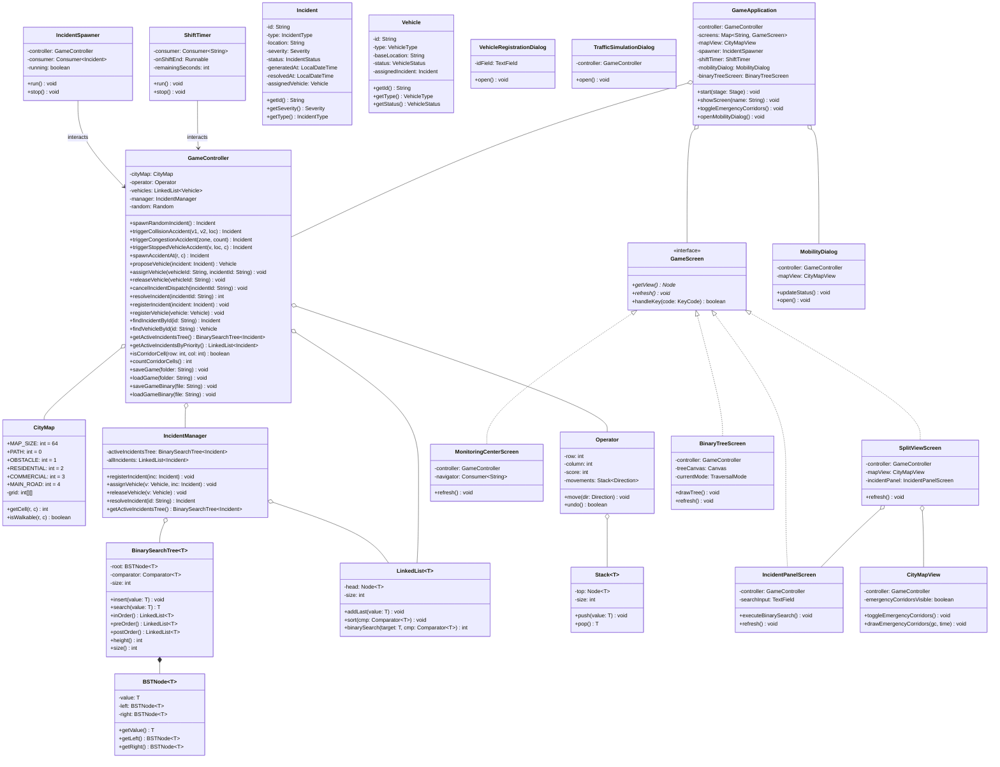

# Diagrama de Clases UML y Patrones de Diseño — SGMMS (Palmira)
## Entrega 3 (Final) — Algoritmos y Programación II (Icesi)
**Equipo:** LaVencida  
**Integrantes:** Juan Pablo Ceballos, Daniel Felipe Herrera Parra, Dayanna Fernández Núñez

---

## 1. Arquitectura General y Patrones de Diseño

El sistema está estructurado bajo el patrón arquitectónico **Modelo-Vista-Controlador (MVC)**, complementado con patrones de diseño orientados a eventos, concurrencia y estructuras de datos:

| Patrón de Diseño | Componentes Clave en SGMMS | Propósito en el Proyecto |
| :--- | :--- | :--- |
| **Model-View-Controller (MVC)** | `model.*` (Modelo), `ui.*` (Vista JavaFX), `GameController` (Controlador) | Desacopla la lógica de negocio, estructuras de datos y persistencia de la interfaz visual retro. |
| **Observer / Callback** | `GameApplication`, `Consumer<String>`, `AnimationTimer`, `Runnable` | Notificación asíncrona de eventos de interfaz (navegación entre pantallas, clics en mapa, actualización de turnos). |
| **Strategy (Comparadores y Búsqueda)** | `IncidentPriorityComparator`, `IncidentIdComparator`, `RouteFinder` (BFS) | Algoritmos intercambiables de ordenamiento, priorización BST y enrutamiento en grafos sobre la red vial. |
| **Active Object / Producer-Consumer** | `IncidentSpawner` (Hilo productor), `ShiftTimer` (Hilo temporizador) | Generación concurrente de incidentes y control del tiempo de simulación con sincronización thread-safe en el controlador. |
| **Composite / Hierarchical Screen** | `GameScreen`, `MonitoringCenterScreen`, `IncidentPanelScreen`, `SplitViewScreen`, `BinaryTreeScreen` | Jerarquía unificada de pantallas intercambiables dentro del `StackPane` principal. |
| **Factory / Registry** | `SpriteRegistry`, `RetroSound` | Centralización de recursos gráficos pixel-art y síntesis procedimental de audio 8 bits. |

---

## 2. Diagrama de Clases UML (PlantUML / Mermaid)

---

## 3. Resumen de Estructuras y Complejidades

1. **Árbol Binario de Búsqueda (`BinarySearchTree<Incident>`)**:
   - Inserción y búsqueda por prioridad: $O(\log n)$ promedio, $O(n)$ peor caso.
   - Recorridos In-Order, Pre-Order, Post-Order: $O(n)$ garantizado.
   - Se utiliza para gestionar y renderizar visualmente la jerarquía de incidentes activos por urgencia en `BinaryTreeScreen`.
2. **Lista Enlazada Doble/Simple (`LinkedList<T>`)**:
   - Inserción al inicio/final: $O(1)$.
   - Búsqueda binaria (`binarySearch`): $O(\log n)$ sobre lista indexada/ordenada por MergeSort ($O(n \log n)$).
3. **Pila LIFO (`Stack<Direction>`)**:
   - Push y Pop de movimientos del operador: $O(1)$. Permite la función de deshacer (`undo`).
4. **Enrutamiento sobre Grafo de Red Vial (`RouteFinder` / BFS)**:
   - Complejidad: $O(V + E)$ sobre las $64 \times 64 = 4096$ celdas de la ciudad de Palmira, priorizando los corredores arteriales `MAIN_ROAD`.
