# Diagrama de Clases UML y Patrones de Diseño — SGMMS (Palmira)
## Entrega 3 (Final) — Algoritmos y Programación II (Icesi)
**Equipo:** LaVencida  
**Integrantes:** Juan Pablo Ceballos, Daniel Felipe Herrera Parra, Dayanna Fernández Núñez

> **Archivo fuente PlantUML (estilo estándar del curso):** [diagrama_clases_sgmms.puml](diagrama_clases_sgmms.puml)

---

## 1. Arquitectura MVC + JavaFX + Canvas y Patrones de Diseño

El sistema sigue estrictamente el patrón arquitectónico **Modelo-Vista-Controlador (MVC)** del curso:
- **El Modelo (`model`, `structures`, `persistence`, `exceptions`) NO importa nada de JavaFX.** Se prueba íntegramente con JUnit (`160` pruebas unitarias sin abrir ventanas).
- **La Vista (`ui`)** renderiza el estado en `Canvas` y componentes JavaFX, y delega las acciones al `GameController`.
- **El Controlador (`controller`)** traduce eventos del usuario en operaciones `synchronized` sobre el modelo, ejecuta cálculos de rutas BFS (`RouteFinder`) y gestiona la concurrencia (`IncidentSpawner`, `ShiftTimer`).

| Patrón de Diseño | Componentes Clave en SGMMS | Propósito en el Proyecto |
| :--- | :--- | :--- |
| **Model-View-Controller (MVC)** | `model.*` (Modelo), `ui.*` (Vista JavaFX), `GameController` (Controlador) | Desacopla la lógica de negocio, estructuras de datos y persistencia de la interfaz visual retro. |
| **Observer / Callback** | `GameApplication`, `Consumer<String>`, `AnimationTimer`, `Runnable` | Notificación asíncrona de eventos de interfaz (navegación entre pantallas, clics en mapa, actualización de turnos). |
| **Strategy (Comparadores y Búsqueda)** | `IncidentPriorityComparator`, `IncidentIdComparator`, `RouteFinder` (BFS) | Algoritmos intercambiables de ordenamiento, priorización BST y enrutamiento en grafos sobre la red vial. |
| **Active Object / Producer-Consumer** | `IncidentSpawner` (Hilo productor), `ShiftTimer` (Hilo temporizador) | Generación concurrente de incidentes y control del tiempo de simulación con sincronización thread-safe en `GameController`. |
| **Composite / Hierarchical Screen** | `GameScreen`, `MonitoringCenterScreen`, `IncidentPanelScreen`, `SplitViewScreen`, `BinaryTreeScreen` | Jerarquía unificada de pantallas intercambiables dentro del `StackPane` principal. |
| **Factory / Registry** | `SpriteRegistry`, `RetroSound` | Centralización de recursos gráficos pixel-art y síntesis procedimental de audio 8 bits. |

---

## 2. Diagrama de Clases UML Completo (Fiel al Código Actual)

```mermaid
classDiagram
    direction TB

    %% ==========================================
    %% PUNTO DE ENTRADA JAVAFX (com.icesi)
    %% ==========================================
    class Launcher {
        +main(args: String[])$ void
    }
    class Application {
        <<JavaFX>>
    }
    class Canvas {
        <<JavaFX>>
    }
    class GameApplication {
        -controller: GameController
        -hud: HudBar
        -content: StackPane
        -titleScreen: TitleScreen
        -centerScreen: MonitoringCenterScreen
        -spawner: IncidentSpawner
        -shiftTimer: ShiftTimer
        -shiftEndView: ShiftEndView
        -pauseView: PauseView
        -helpView: HelpView
        -optionsView: OptionsView
        -registrationDialog: IncidentRegistrationDialog
        -vehicleDialog: VehicleRegistrationDialog
        -trafficDialog: TrafficSimulationDialog
        -mobilityDialog: MobilityDialog
        -statisticsDialog: StatisticsDialog
        -binaryTreeScreen: BinaryTreeScreen
        -mapView: CityMapView
        -screens: Map~String, GameScreen~
        -currentScreen: GameScreen
        +start(stage: Stage) void
        +showScreen(name: String) void
        +openRegistrationDialog() void
        +openVehicleRegistrationDialog() void
        +openTrafficSimulationDialog() void
        +openMobilityDialog() void
        +openStatisticsDialog() void
        +toggleEmergencyCorridors() void
        -handleKey(code: KeyCode) void
        -refreshAll() void
    }

    Launcher ..> GameApplication : delega main()
    Application <|-- GameApplication

    %% ==========================================
    %% CAPA VISTA (com.icesi.ui)
    %% ==========================================
    class GameScreen {
        <<interface>>
        +getView()* Node
        +refresh()* void
        +handleKey(code: KeyCode) boolean
    }
    class TitleScreen {
        -root: Pane
        -canvas: Canvas
        -selected: int
        -record: int
        +getView() Node
        +start() void
        +stop() void
        +moveSelection(step: int) void
        +getSelectedOption() String
        +selectAt(y: double) boolean
    }
    class MonitoringCenterScreen {
        -controller: GameController
        -navigator: Consumer~String~
        -eventLog: EventLog
        -miniMap: MiniMap
        +getView() Node
        +refresh() void
        +handleKey(code: KeyCode) boolean
        +showEvent(message: String) void
    }
    class IncidentPanelScreen {
        -controller: GameController
        -eventLog: EventLog
        -selected: Incident
        -focusedId: String
        -searchInput: TextField
        +getView() Node
        +getCompactView() Node
        +executeBinarySearch() void
        +clearSearch() void
        +refresh() void
        +handleKey(code: KeyCode) boolean
    }
    class SplitViewScreen {
        -controller: GameController
        -mapView: CityMapView
        -incidentPanel: IncidentPanelScreen
        +getView() Node
        +refresh() void
        +handleKey(code: KeyCode) boolean
    }
    class BinaryTreeScreen {
        -controller: GameController
        -navigator: Consumer~String~
        -treeCanvas: Canvas
        -currentMode: TraversalMode
        -selectedIncident: Incident
        +getView() Node
        +refresh() void
        +handleKey(code: KeyCode) boolean
        -drawTree() void
    }
    class CityMapView {
        +CELL: double = 11$
        -controller: GameController
        -cityLayer: Canvas
        -spriteLayer: Canvas
        -nightLayer: Canvas
        -vehicleAnimator: VehicleAnimator
        -emergencyCorridorsVisible: boolean
        +getView() Node
        +toggleEmergencyCorridors() void
        +isEmergencyCorridorsVisible() boolean
        +hasArrived(v: Vehicle) boolean
        +setFocusedIncident(id: String) void
        +shake() void
        -drawSprites(time: double) void
        -drawEmergencyCorridors(gc: GraphicsContext, time: double) void
    }
    class CityRenderer {
        -cityMap: CityMap
        -cell: double
        +drawCity(gc: GraphicsContext) void
    }
    class VehicleAnimator {
        -controller: GameController
        -routeFinder: RouteFinder
        +update(delta: double) void
        +positionOf(v: Vehicle) double[]
        +isMoving(v: Vehicle) boolean
        +hasArrived(v: Vehicle) boolean
    }
    class HudBar {
        +refresh(controller: GameController) void
        +setShiftTime(text: String, lastMinute: boolean) void
        +setActiveScreen(screen: String) void
        +setCorridorsActive(active: boolean) void
    }
    class MobilityDialog {
        -controller: GameController
        -mapView: CityMapView
        +updateStatus() void
        +open() void
    }
    class StatisticsDialog {
        -controller: GameController
        -highScores: HighScoreStore
        +refreshStats() void
        +open() void
    }
    class IncidentRegistrationDialog {
        +open() void
    }
    class VehicleRegistrationDialog {
        +open() void
    }
    class TrafficSimulationDialog {
        -controller: GameController
        +open() void
    }
    class ShiftEndView {
        +show(result: ShiftTimer.Result, score: int) void
    }

    GameScreen <|.. MonitoringCenterScreen
    GameScreen <|.. IncidentPanelScreen
    GameScreen <|.. SplitViewScreen
    GameScreen <|.. BinaryTreeScreen
    SplitViewScreen o-- "1" CityMapView
    SplitViewScreen o-- "1" IncidentPanelScreen
    CityMapView --> "1" CityRenderer : usa
    CityMapView --> "1" VehicleAnimator : anima
    CityMapView ..> Canvas : dibuja en
    BinaryTreeScreen ..> Canvas : dibuja en

    %% ==========================================
    %% CAPA CONTROLADOR (com.icesi.controller)
    %% ==========================================
    class GameController {
        +FAST_LIMIT_SECONDS: int = 30$
        +FAST_BONUS_POINTS: int = 50$
        +WAIT_PENALTY_POINTS: int = 25$
        -cityMap: CityMap
        -operator: Operator
        -vehicles: LinkedList~Vehicle~
        -manager: IncidentManager
        -random: Random
        +createInitialVehicles()$ LinkedList~Vehicle~
        +moveOperator(direction: Direction) boolean
        +undoOperatorMove() boolean
        +spawnRandomIncident() Incident
        +triggerCollisionAccident(v1: String, v2: String, loc: String) Incident
        +triggerCongestionAccident(zone: String, count: int) Incident
        +triggerStoppedVehicleAccident(v: String, loc: String, cycles: int) Incident
        +spawnAccidentAt(row: int, col: int) Incident
        +proposeVehicle(incident: Incident) Vehicle
        +assignVehicle(vehicleId: String, incidentId: String) void
        +releaseVehicle(vehicleId: String) void
        +cancelIncidentDispatch(incidentId: String) void
        +resolveIncident(incidentId: String) int
        +registerIncident(incident: Incident) void
        +registerVehicle(vehicle: Vehicle) void
        +findIncidentById(incidentId: String) Incident
        +findVehicleById(vehicleId: String) Vehicle
        +getActiveIncidentsTree() BinarySearchTree~Incident~
        +getActiveIncidentsByPriority() LinkedList~Incident~
        +getActiveIncidentCount() int
        +getResolvedIncidentCount() int
        +getTotalIncidentCount() int
        +isCorridorCell(row: int, col: int) boolean
        +countCorridorCells() int
        +saveGame(folder: String) void
        +loadGame(folder: String) void
        +saveGameBinary(file: String) void
        +loadGameBinary(file: String) void
    }
    class IncidentSpawner {
        -controller: GameController
        -onSpawn: Consumer~Incident~
        -running: boolean
        +start() void
        +stop() void
        +run() void
    }
    class ShiftTimer {
        -onTick: Consumer~String~
        -onEnd: Consumer~Result~
        +start() void
        +stop() void
        +run() void
    }
    class RouteFinder {
        -cityMap: CityMap
        +findPath(fromRow: int, fromCol: int, toRow: int, toCol: int) LinkedList~int[]~
    }
    class MapPositionResolver {
        -cityMap: CityMap
        +cellOf(incident: Incident) int[]
        +stationOf(vehicle: Vehicle) int[]
    }

    GameApplication o-- "1" GameController : controller
    GameApplication o-- "*" GameScreen : screens
    GameApplication o-- "1" MobilityDialog
    GameApplication o-- "1" StatisticsDialog
    GameApplication o-- "1" TitleScreen
    GameApplication o-- "1" ShiftEndView
    GameApplication --> "1" IncidentSpawner
    GameApplication --> "1" ShiftTimer
    IncidentSpawner --> "1" GameController : spawnRandomIncident()
    VehicleAnimator --> "1" RouteFinder : calcula BFS

    %% ==========================================
    %% CAPA MODELO Y ESTRUCTURAS (SIN JAVAFX)
    %% ==========================================
    class CityMap {
        +MAP_SIZE: int = 64$
        +PATH: int = 0$
        +OBSTACLE: int = 1$
        +RESIDENTIAL: int = 2$
        +COMMERCIAL: int = 3$
        +MAIN_ROAD: int = 4$
        -grid: int[][]
        +getSize() int
        +isInsideBounds(row: int, col: int) boolean
        +getCell(row: int, col: int) int
        +isWalkable(row: int, col: int) boolean
    }
    class Operator {
        -row: int
        -column: int
        -score: int
        -movementHistory: Stack~Movement~
        +move(direction: Direction, map: CityMap) boolean
        +undoLastMovement() Movement
        +addScore(points: int) void
        +subtractScore(points: int) void
        +getMovementCount() int
    }
    class Movement {
        -fromRow: int
        -fromCol: int
        -toRow: int
        -toCol: int
        -direction: Direction
    }
    class Vehicle {
        -id: String
        -type: VehicleType
        -location: String
        -status: VehicleStatus
        -assignedIncident: Incident
        +isCompatibleWith(type: IncidentType) boolean
    }
    class Incident {
        -id: String
        -type: IncidentType
        -location: String
        -severity: Severity
        -status: IncidentStatus
        -generatedAt: LocalDateTime
        -resolvedAt: LocalDateTime
        -description: String
        -assignedVehicle: Vehicle
    }
    class IncidentManager {
        -incidents: LinkedList~Incident~
        -activeIncidentsTree: BinarySearchTree~Incident~
        +registerIncident(incident: Incident) void
        +findIncidentById(id: String) Incident
        +getHighestPriorityIncident() Incident
        +proposeCandidateVehicle(inc: Incident, vehicles: LinkedList~Vehicle~) Vehicle
        +assignVehicle(inc: Incident, v: Vehicle) void
        +releaseVehicle(v: Vehicle) void
        +finishAttention(inc: Incident, op: Operator, now: LocalDateTime) int
        +getActiveIncidentsByPriority() LinkedList~Incident~
        +getActiveIncidentsTree() BinarySearchTree~Incident~
        +getActiveIncidentCount() int
        +getResolvedIncidentCount() int
    }
    class IncidentGenerator {
        +generateRandomIncident() Incident
        +detectCollisionAccident(v1: String, v2: String, loc: String) Incident
        +detectCongestionAccident(zone: String, count: int) Incident
        +detectStoppedVehicleAccident(v: String, loc: String, cycles: int) Incident
    }
    class BinarySearchTree~T~ {
        -root: BSTNode~T~
        -comparator: Comparator~T~
        -size: int
        +insert(value: T) void
        +contains(value: T) boolean
        +search(value: T) T
        +remove(value: T) boolean
        +inOrder() LinkedList~T~
        +preOrder() LinkedList~T~
        +postOrder() LinkedList~T~
        +height() int
        +size() int
        +getRoot() BSTNode~T~
    }
    class BSTNode~T~ {
        -value: T
        -left: BSTNode~T~
        -right: BSTNode~T~
    }
    class LinkedList~T~ {
        -head: Node~T~
        -tail: Node~T~
        -size: int
        +addFirst(value: T) void
        +addLast(value: T) void
        +get(index: int) T
        +remove(index: int) T
        +sort(cmp: Comparator~T~) void
        +binarySearch(target: T, cmp: Comparator~T~) int
        +size() int
    }
    class Stack~T~ {
        -top: Node~T~
        -size: int
        +push(value: T) void
        +pop() T
        +peek() T
        +isEmpty() boolean
    }
    class JsonPersistence {
        +save(folder: Path, op: Operator, vehicles: LinkedList~Vehicle~, incidents: LinkedList~Incident~)$ void
        +load(folder: Path)$ GameState
    }
    class SerializationPersistence {
        +save(file: Path, state: Serializable)$ void
        +load(file: Path)$ Object
    }
    class HighScoreStore {
        -file: Path
        +load() int
        +saveIfHigher(score: int) boolean
    }

    GameController o-- "1" CityMap : cityMap
    GameController o-- "1" Operator : operator
    GameController o-- "1" IncidentManager : manager
    GameController o-- "1" LinkedList : vehicles
    GameController ..> JsonPersistence : F5 / F9
    GameController ..> SerializationPersistence : F6 / F10

    IncidentManager o-- "1" BinarySearchTree : activeIncidentsTree
    IncidentManager o-- "1" LinkedList : incidents
    BinarySearchTree *-- "0..1" BSTNode
    Operator *-- "1" Stack : movementHistory
    Operator *-- "*" Movement
    Vehicle "0..1" --> "0..1" Incident : assignedIncident
    IncidentManager o-- "0..*" Incident
```

---

## 3. Estructuras, Enumeraciones, Excepciones y Complejidades

- **Enumeraciones (`model`)**: `Direction (UP, DOWN, LEFT, RIGHT)`, `IncidentType (ACCIDENT, THEFT, FIRE)`, `IncidentStatus (PENDING, IN_PROGRESS, RESOLVED)`, `Severity (HIGH, MEDIUM, LOW)`, `VehicleType (AMBULANCE, PATROL, FIRE_TRUCK)`, `VehicleStatus (AVAILABLE, BUSY)`.
- **Excepciones propias (`exceptions`)**: `DuplicateIncidentException`, `EmptyStructureException`, `IncidentNotFoundException`, `IncidentStateException`, `NoActiveIncidentsException`, `PersistenceException`, `VehicleAssignmentException`, `VehicleReleaseException`.
- **Complejidades**:
  1. `BinarySearchTree<Incident>`: Inserción/búsqueda $O(\log n)$ promedio; recorridos `inOrder`, `preOrder`, `postOrder` $O(n)$.
  2. `LinkedList<T>`: Inserción al inicio/final $O(1)$; ordenamiento MergeSort $O(n \log n)$ y `binarySearch` $O(\log n)$.
  3. `Stack<Movement>`: `push` y `pop` en $O(1)$ para deshacer movimientos.
  4. `RouteFinder` (BFS): $O(V + E)$ sobre la matriz $64 \times 64 = 4096$ celdas de Palmira.
